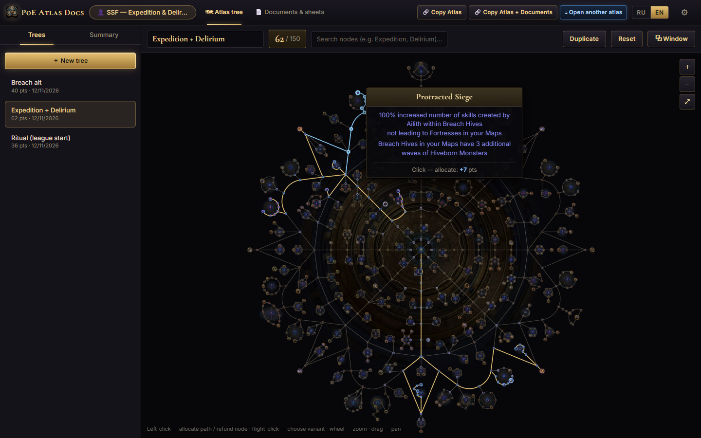
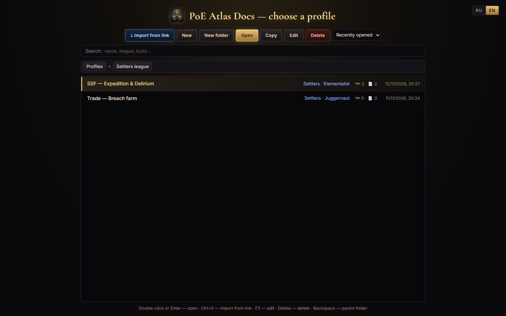
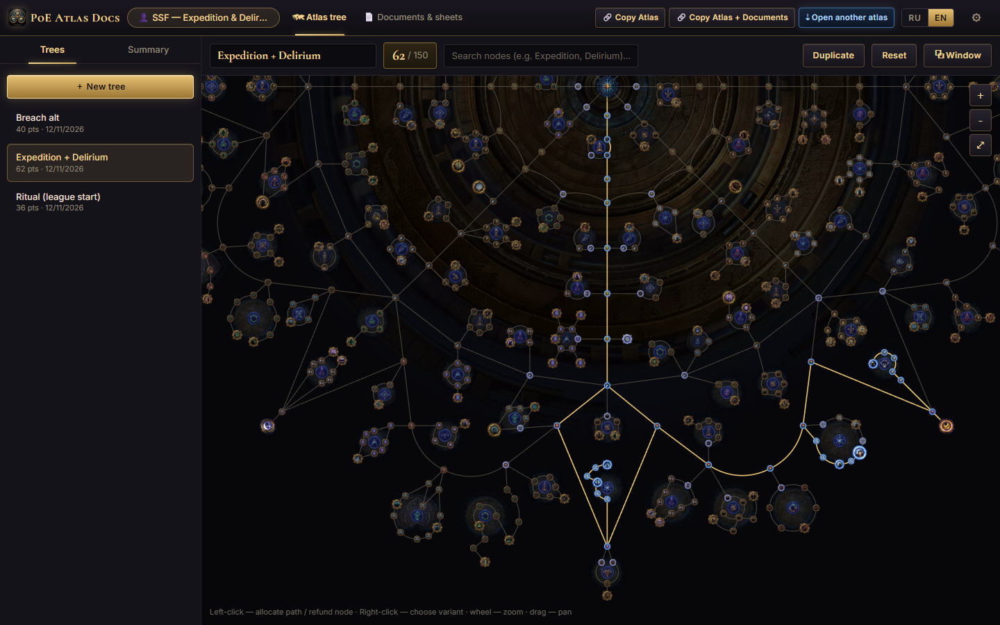
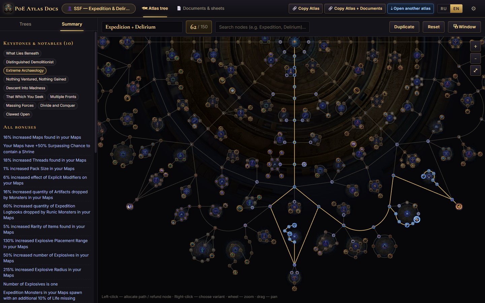
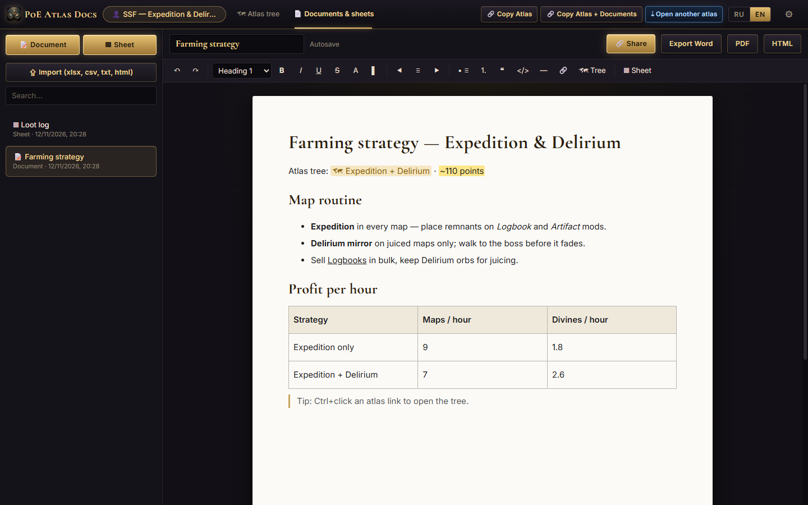
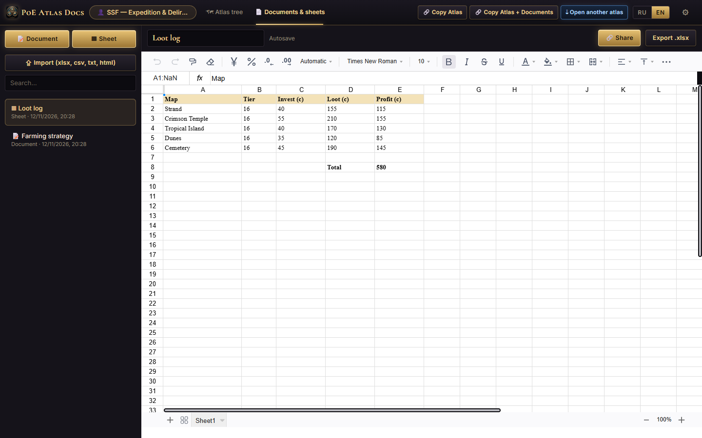
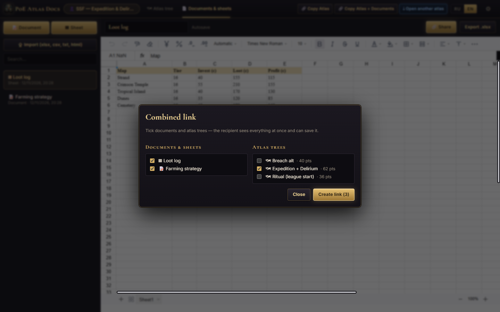
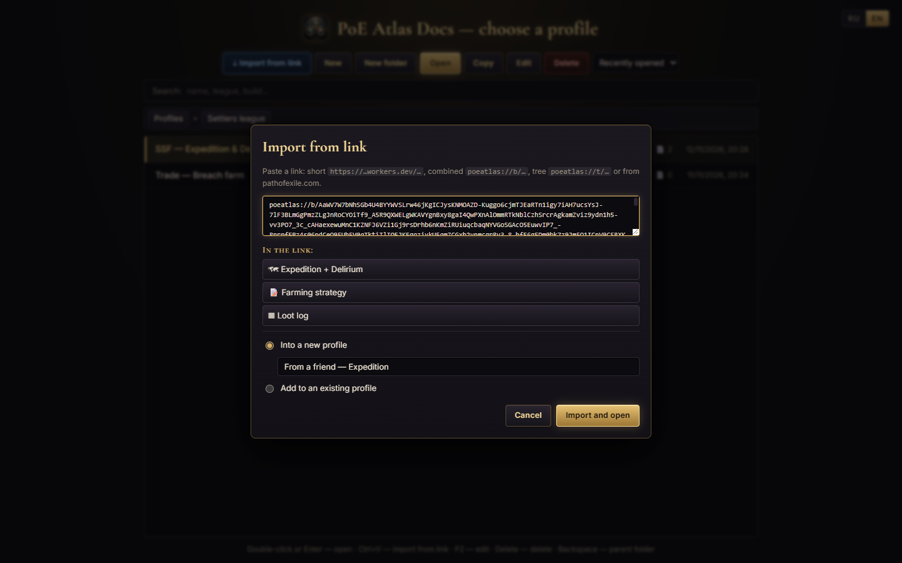

<p align="center">
  
</p>

<h1 align="center">PoE Atlas Docs</h1>

<p align="center">
  <a href="README.md"><b>English</b></a> · <a href="README.ru.md">Русский</a>
</p>

<p align="center">
  <b>A desktop companion for Path of Exile 1</b> — plan your Atlas passive tree, keep farming notes and loot sheets,<br/>
  and share everything with a single short link.
</p>

<p align="center">
  <a href="../../releases/latest"><b>⬇ Download for Windows</b></a> ·
  <a href="#features">Features</a> ·
  <a href="#screenshots">Screenshots</a> ·
  <a href="#sharing-links">Sharing</a> ·
  <a href="#building-from-source">Build from source</a>
</p>

<p align="center">
  
</p>

---

## What is it?

**PoE Atlas Docs** is a free Windows app for Path of Exile 1 players who plan their mapping strategies seriously.
It combines three things that usually live in different browser tabs:

1. **An Atlas passive tree planner** that behaves like the in-game tree — built from Grinding Gear Games' official tree
   export, with the original artwork.
2. **Word- and Excel-style documents** for strategy notes, profit tables and loot logs, stored next to your trees.
3. **Short shareable links** — send a friend one link and they get your atlas tree *and* your notes in their copy of the app.

Everything is organised into **profiles** (one per league, character or strategy), just like the build list in Path of Building.
The interface is available in **English and Russian**.

## Features

### 🗺 Atlas passive tree planner
- Official atlas tree data and sprites (`grindinggear/atlastree-export`) — nodes, groups, orbits, masteries and gateways look like in game.
- **In-game style allocation:** hover a node to see the shortest path (highlighted in blue) and its point cost; click to allocate the whole path.
- **Refunding:** click an allocated node to remove it together with every node that would lose its connection to the start (previewed in red).
- Cryptic/Mortal **gateways** connect their pairs; **multiple-choice notables** — right-click to pick a variant.
- Node search, point counter, a **summary** of all bonuses (identical stats are summed up), keystones & notables list, and notes per tree.
- Multiple trees per profile, duplicate / reset, and a **separate window** for the tree (great on a second monitor).

### 👤 Profiles
- A start screen in the spirit of Path of Building: **New, New folder, Open, Copy, Edit, Delete**, sorting and search across folders.
- Every profile has its own trees and documents; the app remembers the last open tab, tree and document of each profile.
- **Import from link** right from the start screen (or just press **Ctrl+V**): preview what is inside the link, then save it into a new or existing profile in one click.

### 📄 Documents & sheets
- **Rich-text documents** (TipTap): headings, lists, colours, highlights, alignment, quotes, code, tables, links.
  Insert a link to any of your atlas trees with one button; Ctrl+click opens it.
- **Spreadsheets** (Fortune-sheet): formulas, formatting, multiple sheets.
- Import `.xlsx / .xls / .csv / .ods / .txt / .html`; export to **Excel (.xlsx), Word (.doc), PDF and HTML**.
- Autosave — edits are written to disk as you type and flushed when you switch documents or close the window.

### 🔗 Sharing links
- **Copy Atlas** — a short link to the open tree.
- **Copy Atlas + Documents** — one link with the tree *and* all documents of the profile.
- **Open another atlas** — paste any link and the tree opens instantly (view-only until you save it).
- Supported link types: short `https://…workers.dev/AbC123x`, combined `poeatlas://b/…`, tree `poeatlas://t/…`
  (a full 132-point tree fits in ~50 characters) and official **pathofexile.com** atlas tree links.

### 🛡 Your data is safe
- Data is stored locally as JSON in `%APPDATA%\PoE Atlas Docs\storage`.
- An **automatic backup** of all profiles, trees and documents is made on every launch (last 15 kept in `storage\.backups`).
- Nothing is deleted permanently — deleted items go to `storage\.trash` and can be restored by hand.
- Writes are atomic and retried if Windows briefly locks a file (antivirus, indexer, sync tools).

### 🎨 “Atlas Forge” interface
Dark forged metal, gold trim and a classic serif typeface — designed in Figma and inspired by Path of Exile.
Fonts are bundled, so the app works fully offline.

## Screenshots

| Profiles | Atlas tree — zoomed in |
| --- | --- |
|  |  |
| **Summary of all bonuses** | **Strategy document** |
|  |  |
| **Loot sheet with formulas** | **Combined link: tree + documents** |
|  |  |
| **Import from link** | |
|  | |

## Download & install

1. Go to **[Releases](../../releases/latest)** and download one of:
   - `PoE.Atlas.Docs.Setup.x.y.z.exe` — installer (creates Start-menu and desktop shortcuts, registers `poeatlas://` links);
   - `PoE.Atlas.Docs.x.y.z.Portable.exe` — portable version, no installation needed.
2. The app is not code-signed yet, so Windows SmartScreen may show *“Windows protected your PC”*.
   Click **More info → Run anyway**.

Updating is safe: install the new version over the old one. Your profiles, trees and documents are stored separately.

### Verifying your download

Every release ships a `SHA256SUMS.txt` next to the installers. To check that the file you downloaded
is the one that was built:

```powershell
Get-FileHash ".\PoE.Atlas.Docs.Setup.1.0.2.exe" -Algorithm SHA256
```

Compare the hash with `SHA256SUMS.txt`. The releases are built in GitHub Actions, so you can also
check the build provenance:

```bash
gh attestation verify "PoE.Atlas.Docs.Setup.1.0.2.exe" --repo Twofoo/poe-atlas-docs
```

VirusTotal reports for the 1.0.2 binaries (the hashes match `SHA256SUMS.txt`):

- [Portable build](https://www.virustotal.com/gui/file/66b3a9dfc2c12988cb25d4d4538aa3dc7cbbc0af0a2dce094eb374cc49870838)
- [Installer](https://www.virustotal.com/gui/file/5ffbb4ddef9074e54dd612646e6fbb8bcd643462fcadd10f9b369a20562e5bee)

## Privacy

This program will not transfer any information to other networked systems unless specifically requested
by the user or the person installing or operating it.

Profiles, trees and documents are stored locally in `%APPDATA%\PoE Atlas Docs\storage`. The optional
short-link service receives only the encoded tree or profile package when you choose to create or open a
short link. There is no telemetry and no account. See [PRIVACY.md](PRIVACY.md) for details.

## How to use

| Action | How |
| --- | --- |
| Allocate a path | Left-click a node (hover first to see the path and cost) |
| Refund nodes | Left-click an allocated node |
| Choose a notable variant | Right-click the node |
| Zoom / pan | Mouse wheel / drag |
| Open a profile | Double-click or **Enter** on the start screen |
| Import a link | **Ctrl+V** on the start screen, or **⇣ Open another atlas** in the top bar |
| Rename / delete a profile | **F2** / **Delete** |
| Open a tree link inside a document | **Ctrl+click** |
| Switch language | **RU / EN** in the top bar or on the start screen |

## Sharing links

Links are designed to work **without any server**: a tree link contains the whole allocation encoded as a breadth-first
walk of the tree (one bit per explored neighbour), so a full tree is only ~50 characters. Combined links contain the tree(s)
and documents compressed with deflate.

**Short links** (`https://poeatlas-links.<subdomain>.workers.dev/AbC123x`) are clickable in Discord and Telegram and open a
small page that launches the app. They are served by a tiny Cloudflare Worker that only stores the encoded package —
no accounts, no tracking. The worker lives in [`server/`](server/) and runs on Cloudflare's free tier;
see [`server/README.md`](server/README.md) to host your own and set its address in `src/config.js`.

## Building from source

Requirements: **Node.js 20+** and Windows (for the installer build).

```bash
npm install
npm run dev        # Vite + Electron with hot reload
npm start          # production build + run
npm test           # tree logic, link codecs and bundle tests
npm run dist       # installer + portable .exe in release/
```

Other scripts:

```bash
npm run i18n:check                 # every UI string has an English translation
npm run icons                      # regenerate icons from build/icon-source.webp (needs Python + Pillow)
node scripts/make-screenshots.mjs  # regenerate README screenshots (run `npx vite` first)
```

### Project structure

```
electron/             main process: storage (JSON files, backups, trash), windows, poeatlas:// protocol
src/atlas/            tree geometry & pathing (tree.js), link codecs (codec.js), canvas renderer, atlas page
src/docs/             documents (TipTap) and spreadsheets (Fortune-sheet), import/export
src/profiles/         profile storage, start screen, import-from-link dialog
src/share/            combined links, short-link client, share / receive dialogs
src/i18n*.js          translations (Russian keys → English)
server/               Cloudflare Worker for short links
data/, public/atlas/  official atlas tree data and sprites
tests/                node:test suites
```

### Updating the atlas tree after a patch

Download the latest `data.json` and sprite sheets from
[grindinggear/atlastree-export](https://github.com/grindinggear/atlastree-export) into `data/` and `public/atlas/`, then rebuild.
Node IDs in Path of Exile are stable across patches, so existing trees keep working.

## Tech stack

Electron · React · Vite · HTML5 Canvas · TipTap / ProseMirror · Fortune-sheet · SheetJS · Cloudflare Workers + KV

## Credits & disclaimer

- Atlas tree data and artwork © **Grinding Gear Games**, from their official
  [atlastree-export](https://github.com/grindinggear/atlastree-export) repository.
- Fonts: Cormorant Garamond / Cormorant SC and Inter, SIL Open Font License.
- See [THIRD_PARTY_NOTICES.md](THIRD_PARTY_NOTICES.md) for details.

This is a fan-made tool. It is **not affiliated with or endorsed by Grinding Gear Games**.


## License

[MIT](LICENSE)
