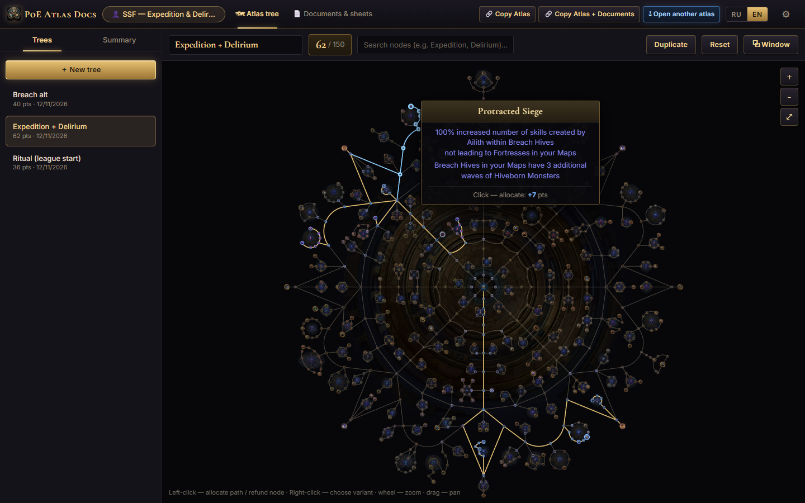
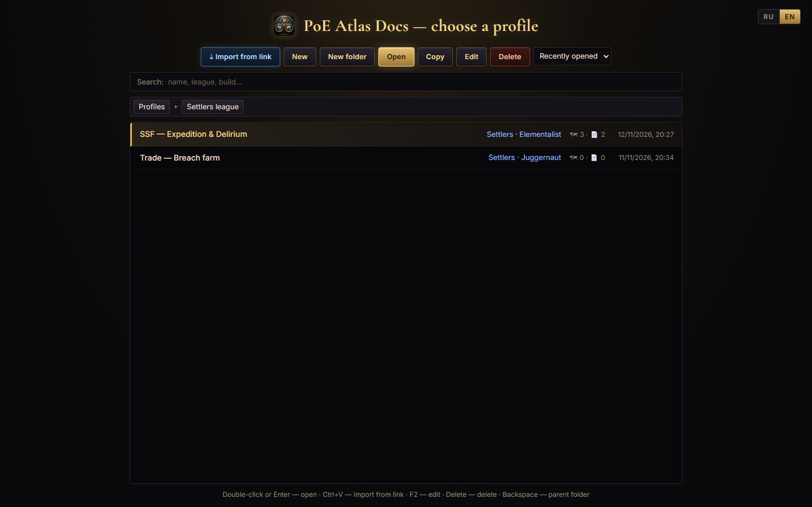
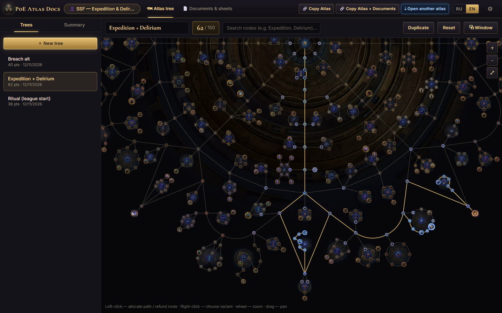
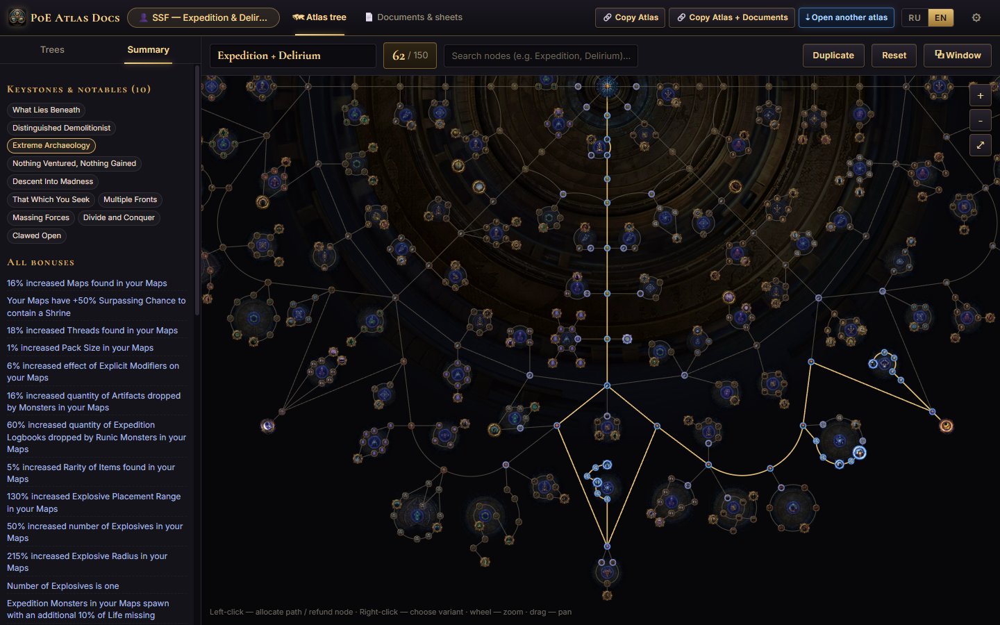
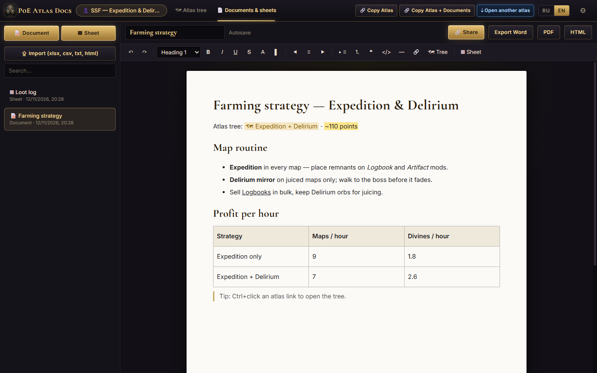
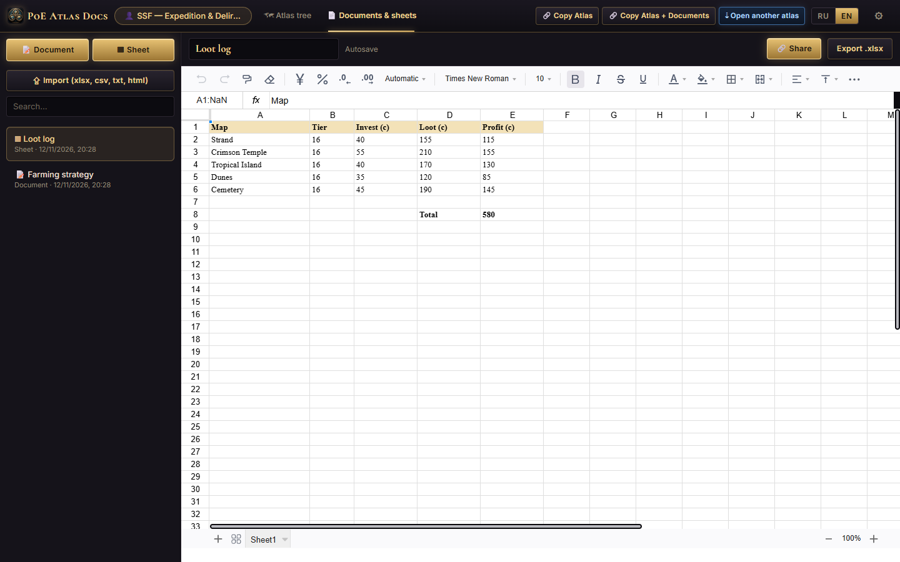
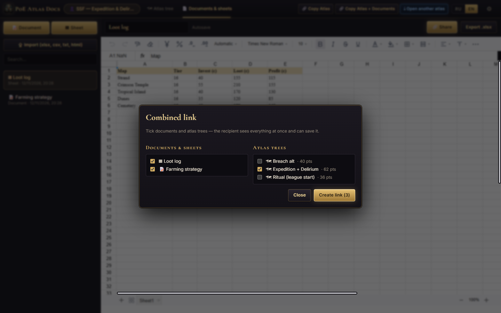
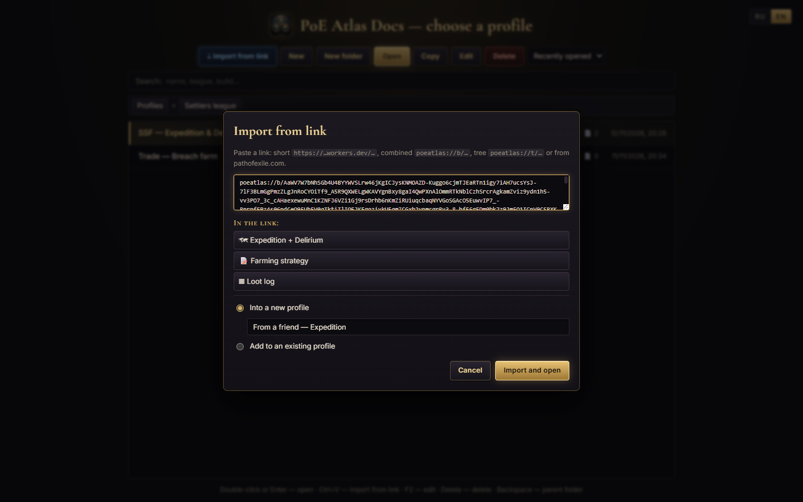

<p align="center">
  
</p>

<h1 align="center">PoE Atlas Docs</h1>

<p align="center">
  <a href="README.md">English</a> · <a href="README.ru.md"><b>Русский</b></a>
</p>

<p align="center">
  <b>Настольный помощник для Path of Exile 1</b> — планируйте дерево Атласа, ведите заметки и таблицы фарма<br/>
  и делитесь всем этим одной короткой ссылкой.
</p>

<p align="center">
  <a href="../../releases/latest"><b>⬇ Скачать для Windows</b></a> ·
  <a href="#возможности">Возможности</a> ·
  <a href="#скриншоты">Скриншоты</a> ·
  <a href="#ссылки-для-обмена">Ссылки</a> ·
  <a href="#сборка-из-исходников">Сборка из исходников</a>
</p>

<p align="center">
  
</p>

---

## Что это?

**PoE Atlas Docs** — бесплатное приложение для Windows для игроков в Path of Exile 1, которые серьёзно подходят к планированию фарма.
Оно объединяет три вещи, которые обычно живут в разных вкладках браузера:

1. **Планировщик дерева пассивок Атласа**, который ведёт себя как игровое дерево — на официальных данных
   Grinding Gear Games и с оригинальной графикой.
2. **Документы в стиле Word и таблицы в стиле Excel** для заметок по стратегии, таблиц прибыли и логов добычи — рядом с деревьями.
3. **Короткие ссылки для обмена** — отправьте другу одну ссылку, и он получит ваше дерево *и* заметки в своей копии приложения.

Всё организовано в **профили** (по одному на лигу, персонажа или стратегию), как список билдов в Path of Building.
Интерфейс доступен на **русском и английском**.

## Возможности

### 🗺 Планировщик дерева Атласа
- Официальные данные и спрайты дерева (`grindinggear/atlastree-export`) — узлы, группы, орбиты, мастери и гейтвеи выглядят как в игре.
- **Выделение как в игре:** наведитесь на узел, чтобы увидеть кратчайший путь (подсвечен синим) и его стоимость; клик выделяет весь путь.
- **Возврат очков:** клик по выделенному узлу снимает его вместе со всеми узлами, которые потеряют связь со стартом (предпросмотр красным).
- Cryptic/Mortal **гейтвеи** соединяют свои пары; **нотаблы с выбором** — правый клик переключает вариант.
- Поиск по узлам, счётчик очков, **сводка всех бонусов** (одинаковые статы суммируются), список кистоунов и нотаблов, заметки к каждому дереву.
- Несколько деревьев в профиле, дублирование и сброс, **отдельное окно** для дерева (удобно на втором мониторе).

### 👤 Профили
- Стартовый экран в духе Path of Building: **Новый, Новая папка, Открыть, Копировать, Изменить, Удалить**, сортировка и поиск по папкам.
- У каждого профиля свои деревья и документы; приложение запоминает последнюю вкладку, дерево и документ каждого профиля.
- **Импорт по ссылке** прямо со стартового экрана (или просто **Ctrl+V**): посмотрите, что внутри ссылки, и сохраните в новый или существующий профиль одним кликом.

### 📄 Документы и таблицы
- **Документы с форматированием** (TipTap): заголовки, списки, цвета, выделение, выравнивание, цитаты, код, таблицы, ссылки.
  Вставка ссылки на любое своё дерево одной кнопкой; Ctrl+клик открывает её.
- **Таблицы** (Fortune-sheet): формулы, форматирование, несколько листов.
- Импорт `.xlsx / .xls / .csv / .ods / .txt / .html`; экспорт в **Excel (.xlsx), Word (.doc), PDF и HTML**.
- Автосохранение — правки пишутся на диск по мере ввода и сбрасываются при переключении документа или закрытии окна.

### 🔗 Ссылки для обмена
- **Copy Atlas** — короткая ссылка на открытое дерево.
- **Copy Atlas + Documents** — одна ссылка с деревом *и* всеми документами профиля.
- **Open another atlas** — вставьте любую ссылку, и дерево откроется сразу (только просмотр, пока не сохраните).
- Поддерживаемые типы ссылок: короткая `https://…workers.dev/AbC123x`, комбинированная `poeatlas://b/…`, дерево `poeatlas://t/…`
  (полное дерево на 132 очка умещается примерно в 50 символов) и официальные ссылки на деревья **pathofexile.com**.

### 🛡 Ваши данные в безопасности
- Данные хранятся локально в JSON в `%APPDATA%\PoE Atlas Docs\storage`.
- При каждом запуске делается **автоматический бэкап** всех профилей, деревьев и документов (последние 15 лежат в `storage\.backups`).
- Ничего не удаляется навсегда — удалённое попадает в `storage\.trash` и восстанавливается вручную.
- Запись атомарная и повторяется, если Windows ненадолго заблокировала файл (антивирус, индексатор, синхронизация).

### 🎨 Интерфейс «Atlas Forge»
Тёмный кованый металл, золотая отделка и классический шрифт с засечками — дизайн в Figma, вдохновлённый Path of Exile.
Шрифты встроены, поэтому приложение полностью работает офлайн.

## Скриншоты

| Профили | Дерево Атласа — приближено |
| --- | --- |
|  |  |
| **Сводка всех бонусов** | **Документ со стратегией** |
|  |  |
| **Таблица добычи с формулами** | **Комбинированная ссылка: дерево + документы** |
|  |  |
| **Импорт по ссылке** | |
|  | |

## Скачивание и установка

1. Откройте **[Releases](../../releases/latest)** и скачайте один из файлов:
   - `PoE.Atlas.Docs.Setup.x.y.z.exe` — установщик (ярлыки в меню Пуск и на рабочем столе, регистрирует ссылки `poeatlas://`);
   - `PoE.Atlas.Docs.x.y.z.Portable.exe` — портативная версия, установка не нужна.
2. Приложение пока не подписано кодом, поэтому Windows SmartScreen может показать *«Windows защитила ваш компьютер»*.
   Нажмите **Подробнее → Выполнить в любом случае**.

Обновляться безопасно: ставьте новую версию поверх старой. Профили, деревья и документы хранятся отдельно.

### Проверка загрузки

В каждом релизе рядом с установщиками лежит `SHA256SUMS.txt`. Чтобы проверить, что скачан именно тот файл,
который был собран:

```powershell
Get-FileHash ".\PoE.Atlas.Docs.Setup.1.0.2.exe" -Algorithm SHA256
```

Сверьте хеш с `SHA256SUMS.txt`. Релизы собираются в GitHub Actions, поэтому можно проверить и происхождение сборки:

```bash
gh attestation verify "PoE.Atlas.Docs.Setup.1.0.2.exe" --repo Twofoo/poe-atlas-docs
```

Отчёты VirusTotal для сборок 1.0.2 (хеши совпадают с `SHA256SUMS.txt`):

- [Portable-версия](https://www.virustotal.com/gui/file/66b3a9dfc2c12988cb25d4d4538aa3dc7cbbc0af0a2dce094eb374cc49870838)
- [Установщик](https://www.virustotal.com/gui/file/5ffbb4ddef9074e54dd612646e6fbb8bcd643462fcadd10f9b369a20562e5bee)

## Приватность

Эта программа не передаёт информацию другим сетевым системам, если только об этом не попросил пользователь
или человек, устанавливающий или запускающий её.

Профили, деревья и документы хранятся локально в `%APPDATA%\PoE Atlas Docs\storage`. Необязательный сервис
коротких ссылок получает только закодированный пакет дерева или профиля, когда вы сами создаёте или открываете
короткую ссылку. Телеметрии и аккаунтов нет. Подробности в [PRIVACY.md](PRIVACY.md).

## Как пользоваться

| Действие | Как |
| --- | --- |
| Выделить путь | Левый клик по узлу (сначала наведитесь, чтобы увидеть путь и стоимость) |
| Снять узлы | Левый клик по выделенному узлу |
| Выбрать вариант нотабла | Правый клик по узлу |
| Зум / панорама | Колесо мыши / перетаскивание |
| Открыть профиль | Двойной клик или **Enter** на стартовом экране |
| Импортировать ссылку | **Ctrl+V** на стартовом экране или **⇣ Open another atlas** в верхней панели |
| Переименовать / удалить профиль | **F2** / **Delete** |
| Открыть ссылку на дерево внутри документа | **Ctrl+клик** |
| Сменить язык | **RU / EN** в верхней панели или на стартовом экране |

## Ссылки для обмена

Ссылки работают **без сервера**: ссылка на дерево содержит всё выделение, закодированное обходом в ширину
(один бит на исследованного соседа), поэтому полное дерево — это всего ~50 символов. Комбинированные ссылки
содержат деревья и документы, сжатые deflate.

**Короткие ссылки** (`https://poeatlas-links.<subdomain>.workers.dev/AbC123x`) кликабельны в Discord и Telegram и открывают
небольшую страницу, которая запускает приложение. Их обслуживает маленький Cloudflare Worker, который хранит только закодированный пакет —
без аккаунтов и трекинга. Воркер лежит в [`server/`](server/) и работает на бесплатном тарифе Cloudflare;
см. [`server/README.md`](server/README.md), чтобы поднять свой и прописать его адрес в `src/config.js`.

## Сборка из исходников

Требования: **Node.js 20+** и Windows (для сборки установщика).

```bash
npm install
npm run dev        # Vite + Electron с горячей перезагрузкой
npm start          # продакшн-сборка и запуск
npm test           # тесты логики дерева, кодеков ссылок и пакетов
npm run dist       # установщик + портативный .exe в release/
```

Другие скрипты:

```bash
npm run i18n:check                 # у каждой строки UI есть английский перевод
npm run icons                      # пересобрать иконки из build/icon-source.webp (нужны Python + Pillow)
node scripts/make-screenshots.mjs  # пересобрать скриншоты для README (сначала запустите `npx vite`)
```

### Структура проекта

```
electron/             главный процесс: хранилище (JSON, бэкапы, корзина), окна, протокол poeatlas://
src/atlas/            геометрия и пути дерева (tree.js), кодеки ссылок (codec.js), рендер на canvas, страница Атласа
src/docs/             документы (TipTap) и таблицы (Fortune-sheet), импорт/экспорт
src/profiles/         хранилище профилей, стартовый экран, диалог импорта по ссылке
src/share/            комбинированные ссылки, клиент коротких ссылок, диалоги обмена
src/i18n*.js          переводы (русские ключи → английский)
server/               Cloudflare Worker для коротких ссылок
data/, public/atlas/  официальные данные и спрайты дерева Атласа
tests/                наборы тестов node:test
```

### Обновление дерева Атласа после патча

Скачайте актуальные `data.json` и спрайт-листы из
[grindinggear/atlastree-export](https://github.com/grindinggear/atlastree-export) в `data/` и `public/atlas/`, затем пересоберите.
ID узлов в Path of Exile стабильны между патчами, поэтому существующие деревья продолжают работать.

## Стек технологий

Electron · React · Vite · HTML5 Canvas · TipTap / ProseMirror · Fortune-sheet · SheetJS · Cloudflare Workers + KV

## Благодарности и дисклеймер

- Данные и графика дерева Атласа © **Grinding Gear Games**, из официального
  репозитория [atlastree-export](https://github.com/grindinggear/atlastree-export).
- Шрифты: Cormorant Garamond / Cormorant SC и Inter, SIL Open Font License.
- Подробности в [THIRD_PARTY_NOTICES.md](THIRD_PARTY_NOTICES.md).

Это фанатский инструмент. Он **не связан с Grinding Gear Games и не одобрен ими**.

## Лицензия

[MIT](LICENSE)
